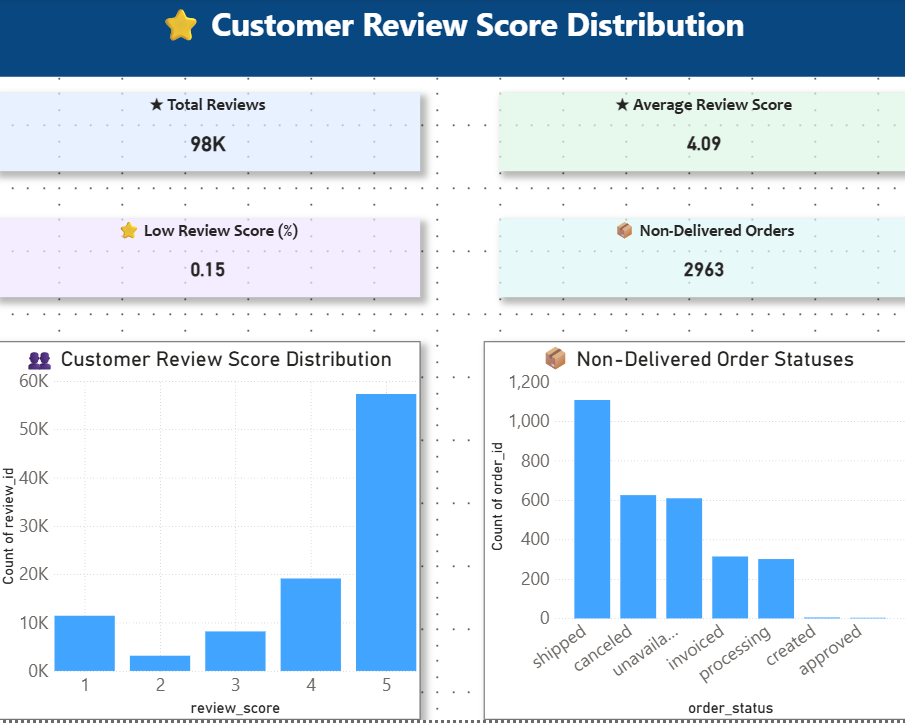
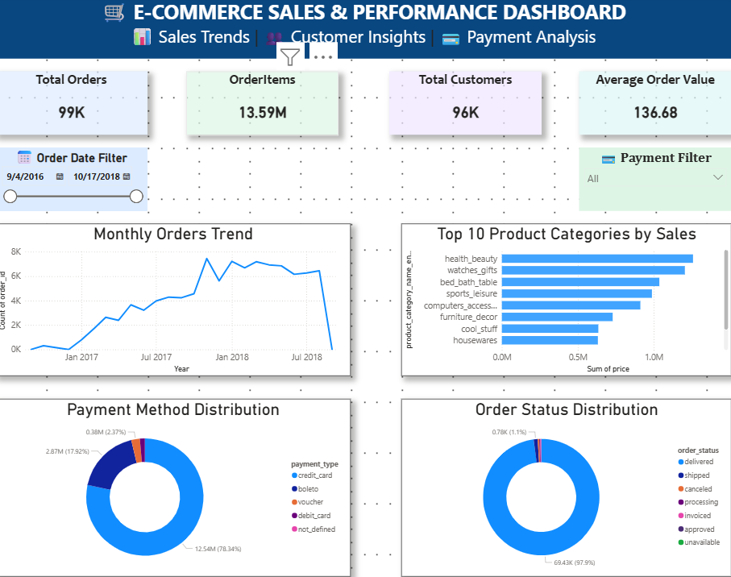

# 🛒 E-Commerce Data Analytics | SQL, Python & Power BI

An end-to-end data analytics project exploring Brazilian e-commerce sales, customer reviews, payment methods, and delivery performance using **MySQL, Python, and Power BI**.

**Author:** KBN Naveen Kumar

## 📊 Dashboard Preview

### 1. Sales Overview



This dashboard provides an overview of order volume, item sales, customers, average order value, monthly order trends, top-selling categories, payment methods, and order status.

### 2. Customer & Delivery Insights



This dashboard explores customer review scores, low review ratings, and non-delivered order statuses.

## 🎯 Project Objectives

- Analyze order volume and monthly sales trends.
- Identify product categories with the highest item sales.
- Understand payment method distribution.
- Evaluate customer review scores.
- Analyze order delivery performance.
- Identify missing values, duplicate records, and data-quality issues.
- Build interactive dashboards to communicate business insights.

## 🛠️ Tools & Technologies

- **MySQL 8.0** — SQL queries, joins, aggregations, and data validation
- **Python** — data exploration, quality checks, KPI calculations, and analysis
- **Pandas** — data manipulation and analysis
- **Matplotlib** — data visualization
- **Power BI** — interactive dashboards and KPI reporting
- **Git & GitHub** — version control and documentation

## 📂 Dataset

This project uses the Olist Brazilian E-Commerce Public Dataset, containing approximately 100,000 orders from 2016–2018.

The dataset includes nine CSV files covering:

- Customers
- Orders
- Order items
- Payments
- Reviews
- Products
- Sellers
- Geolocation
- Product category translations

The original raw CSV files are not included in this GitHub repository. Obtain the dataset from its original distribution source and follow its applicable terms.

## 📁 Project Structure

```text
EcommerceDataAnalytics/
├── sql/
│   ├── 01_data_quality_checks.sql
│   └── 02_business_analysis.sql
├── python/
│   ├── 01_data_exploration.py
│   ├── 02_missing_values_analysis.py
│   ├── 03_product_quality_check.py
│   ├── 04_monthly_orders_analysis.py
│   ├── 05_top_product_categories.py
│   ├── 06_payment_analysis.py
│   └── 07_delivery_performance.py
├── reports/
│   ├── sales_overview.png
│   ├── customer_delivery_insights.png
│   ├── monthly_orders_trend.png
│   ├── top_10_product_categories.png
│   ├── payment_method_analysis.png
│   └── delivery_performance.png
├── data/
│   └── Raw and processed data are kept locally
├── powerbi/
│   └── Power BI dashboard is kept locally
├── .gitignore
└── README.md
```

## 🔍 Data Quality Checks

Validated relationships between:

- Orders and customers
- Order items and orders
- Order items and products
- Order items and sellers
- Payments and orders

The tested relationships returned zero unmatched records.

Additional checks identified:

- Missing product categories and product attributes
- Missing order delivery timestamps
- Missing review titles and comments
- Duplicate geolocation records
- Duplicate review IDs
- Payment records requiring further review

Data-quality exceptions were documented rather than silently removed.

## 💼 Business Questions

1. How are orders distributed by status?
2. How does order volume change month by month?
3. Which months have the highest item sales value?
4. Which product categories generate the highest item sales value?
5. Which payment methods contribute the most recorded payment value?
6. How long does delivery take?
7. What percentage of eligible delivered orders arrive on or before the estimated delivery date?
8. What do customer review scores reveal about customer experience?

## 📈 Key Findings

### Order Performance

- **Total orders:** 99,441
- **Delivered orders:** 96,478
- **Delivered share:** Approximately 97.02%
- **Peak order month:** November 2017, with 7,544 orders

### Product Sales

Top product categories by item sales value:

| Product category | Item sales value |
|---|---:|
| Health & beauty | R$1,258,681.34 |
| Watches & gifts | R$1,205,005.68 |
| Bed, bath & table | R$1,036,988.68 |

November 2017 was the peak month for item sales value, at approximately R$1,010,271.37.

### Payment Analysis

- **Highest-value payment method:** Credit card
- **Recorded credit-card payment value:** R$12,542,084.19
- **Credit-card share of recorded payment value:** Approximately 78.34%

### Delivery Performance

- **Eligible delivered orders:** 96,470
- **Average delivery time:** Approximately 12.50 calendar days
- **On-time deliveries:** 88,644
- **Late deliveries:** 7,826
- **On-time delivery rate:** Approximately 91.89%

Delivery performance uses orders with valid purchase, delivery, and estimated-delivery timestamps. On-time delivery includes orders delivered on or before the estimated delivery date.

*Note: Delivery metrics should be verified against the final Python output before being treated as final results.*

## 🐍 Python Analysis Outputs

The Python scripts generate analysis files under `data/processed/` and visualizations under `reports/`.

Examples include:

- `python_data_quality_summary.csv`
- `missing_values_by_column.csv`
- `monthly_orders_summary.csv`
- `product_category_sales.csv`
- `top_10_product_categories.csv`
- `payment_method_summary.csv`
- `delivery_performance_summary.csv`

Visualizations include monthly order trends, top product categories, payment method analysis, and delivery performance.

## 🧹 Important Data Considerations

- Order purchase dates range from September 2016 to October 2018.
- The final months contain relatively few records and should be interpreted cautiously.
- Some products have missing categories or categories without English translations.
- Payment records and orders are not always one-to-one.
- Item sales value uses order-item prices and excludes freight.
- Payment value is analyzed separately to avoid double-counting through one-to-many joins.
- Missing values and duplicate records are investigated before deciding whether treatment is appropriate.

## ✅ Project Status

- [x] Import raw CSV datasets into MySQL
- [x] Validate key table relationships
- [x] Create SQL business-analysis queries
- [x] Develop Python data-quality and analysis scripts
- [x] Generate analysis charts and reports
- [x] Build interactive Power BI dashboards
- [x] Add dashboard screenshots to GitHub
- [x] Publish project source files on GitHub
- [ ] Verify all final Python outputs
- [ ] Document final business recommendations
- [ ] Publish the Power BI `.pbix` file or a suitable sharing link

## 💡 Business Value

This project demonstrates practical skills in SQL querying, relational data validation, exploratory data analysis, KPI calculation, sales trend analysis, payment analysis, delivery performance measurement, and Power BI dashboard development.

The dashboards help stakeholders explore sales performance, product categories, customer reviews, payment methods, and order outcomes.

## 👨‍💻 Author

**KBN Naveen Kumar**

Data Analytics | SQL | Python | Power BI | MySQL

- **GitHub:** [kbn-naveen-kumar](https://github.com/kbn-naveen-kumar)
- **Project Repository:** [E-Commerce Data Analytics](https://github.com/kbn-naveen-kumar/ecommerce-data-analytics)

If you find this project useful, feel free to explore the repository and its SQL and Python scripts.
